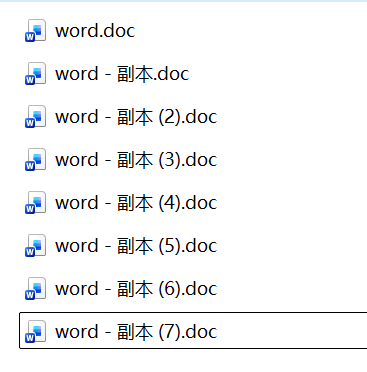
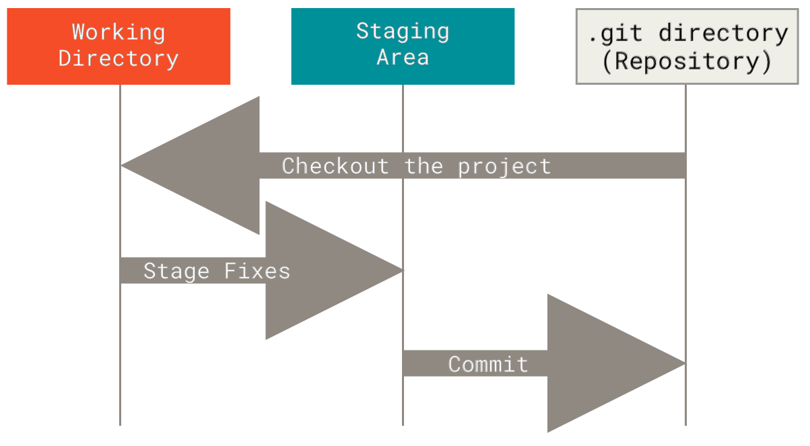
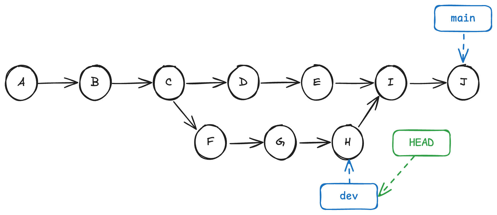
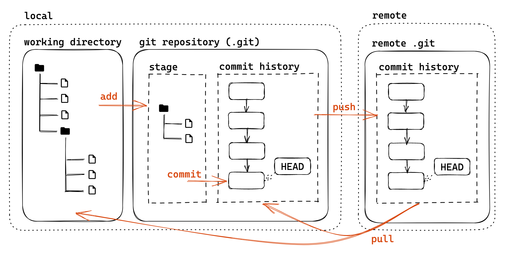
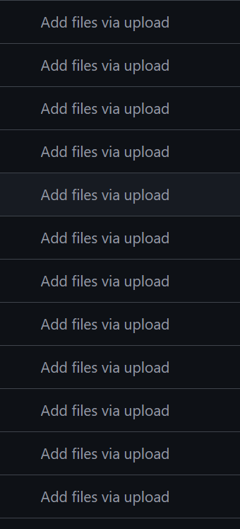
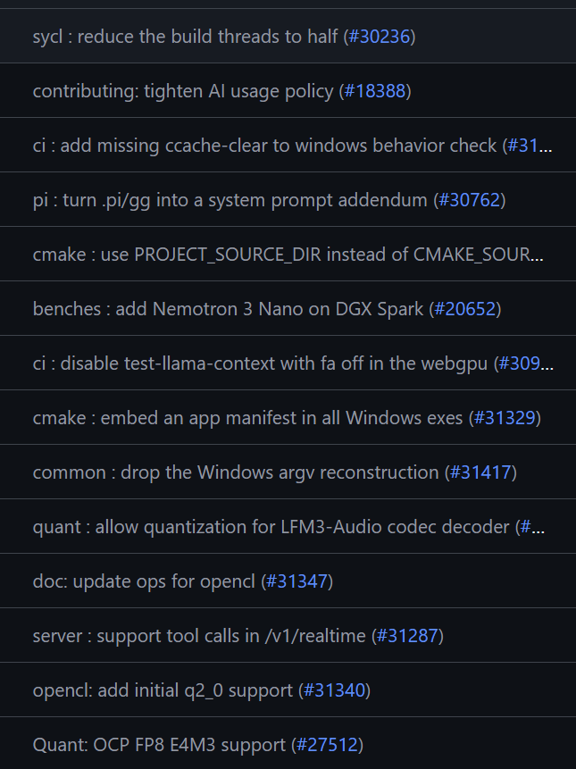
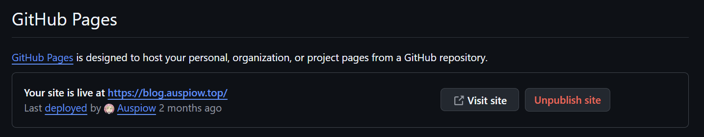

<div class="middle center cover">
<div style="width: 100%">

# Lec 1. Git 与 Github

<hr/>

2026 年秋冬学期计算机学院朋辈辅学「技能拾遗」

<div class="author">
  
  <span>@Auspiow</span>
</div>

2026年10月31日

<!--s-->

<div class="middle center">
<div style="width: 100%">

# Part.1 Git

<!--v-->

## 高效而快速地了解[Git](https://git-scm.com/book/zh/v2/%e8%b5%b7%e6%ad%a5-%e5%85%b3%e4%ba%8e%e7%89%88%e6%9c%ac%e6%8e%a7%e5%88%b6)

Git 是一种版本控制系统（Version Control Systems，VCS）

为什么需要版本控制？

打开你的微信文件存放的地方，也许你会见到



<!--v-->

## 安装Git

* Windows: 前往[官网](https://git-scm.com/install/windows)下载
  * 内带 Git Bash：一个基于 MinGW 的类 Linux shell 环境

* MacOS（大概率已经有了）: 

  ```
  brew install git
  ```

* Linux（大概率已经有了）: 

  ```
  sudo apt update
  sudo apt install git
  ```

<!--v-->

## Git 基础配置

* 初始化一个本地 git 版本库
  
  ```
  git init
  ```
  * 会在当前目录下创建一个名为 .git 的隐藏文件夹，这个文件夹就是 Git 的版本库（Repository）

* git账号配置
  * 多人合作区分用户 / 让 GitHub 能够识别出你
  * 针对某一仓库专门设置：不加 --global
    
    ```
    git config --global user.name "your_name"
    git config --global user.email "your_email"
    ```

* 建议配置commit签名

<!--v-->

## Git 基本模型


图源：[2023 秋冬实用技能拾遗 - TonyCrane](https://slides.tonycrane.cc/PracticalSkillsTutorial/2023-fall-ckc/lec2/#/1/3)

<!--v-->

## Git 基本状态

Git 有三种状态，你的文件可能处于其中之一： 已提交（committed）、已修改（modified） 和 已暂存（staged）

这会让我们的 Git 项目拥有三个阶段：工作区、暂存区以及 Git 目录



<!--v-->

## Add

将新创建或已修改文件的内容添加到索引中。这个“索引(index)”也被称为“暂存区(staging area)”，是用来准备下一次提交内容的地方。

无脑添加所有文件
```
git add .
```

交互式
```
git add -p
```
(1/1) Stage this hunk [y,n,q,a,d,e,p,P,?]?

<!--v-->

## Commit

快照（Snapshot，又称 Commit、提交）
* 每一个快照都由一个十六进制数唯一标识（SHA-1）
* 之后的提交会包括之前提交的 SHA-1，从而形成链式结构



图源：[（24 秋冬）程设辅学](https://ckc-agc.bowling233.top/programming/24fall/lec3/#git_2)

<!--v-->

## Commit Message

直接commit?（Aborting commit due to empty commit message.）
```
git commit
```

我们在提交的时候需要记录更改的原因与内容，方便定位与回溯
```
git commit -m 'feat: I create a new feature'
```

可选用的规范：[约定式提交](https://www.conventionalcommits.org/zh-hans/v1.0.0/)
* 其还可与 [语义化版本](https://semver.org/lang/zh-CN/) 对应
```
1.2.2
fix: correct login error	PATCH ➡ 1.2.3
feat: add search functionality	MINOR ➡ 1.3.3
feat!: redesign public API	MAJOR ➡ 2.0.0
```

<!--s-->

<div class="middle center">
<div style="width: 100%">

# Part 2. GitHub

<!--v-->

## 远程版本库


图源：[2023 秋冬实用技能拾遗 - TonyCrane](https://slides.tonycrane.cc/PracticalSkillsTutorial/2023-fall-ckc/lec2/#/1/3)

<!--v-->

## 远程版本库

GitHub / ZJU Git 最主要的功能是远程版本库

* Git 这样的分布式 VCS 实现中心化协作的关键
* 远程版本库通常是一个裸的 --bare
* git clone / git push / git pull
* 当成一个无限大网盘使用也可行

除此之外 GitHub 也有更强大的功能

* Fork, Pull Request
* 社交功能：Follow, Trend, Star... 可以逛，可以刷
* GitHub 目前需要魔法上网

<!--v-->

## Github 基础使用

Settings > Access > Emails 设置为 git 配置的邮箱

* GitHub 参照版本库中提交者的邮箱将提交者关联至其 GitHub 账号
* 建议配置 GPG 密钥对 commit 进行签名
  * [delete linux because it sucks](https://github.com/torvalds/linux/tree/8bcab0346d4fcf21b97046eb44db8cf37ddd6da0)

<!--v-->

## GitHub 仓库使用

新建 repo，基本设置

添加代码
* 从头开始的空项目：init、add、commit、push
* 从本地非 git 项目上传：init 后修改 remote
* 远程拉取：clone、pull
* 分支、合并：branch / GitHub 上操作

Release：扩展的打 tag

小组项目合作：协作者、私有 Repo 权限管理
* Pull Request、Merge、conflict 处理

<!--v-->

## GitHub 仓库使用

不希望看到的 vs 希望看到的
<div style="display: flex; gap: 20px; align-items: flex-start;">
  
  
</div>

<!--v-->

## GitHub Pages

GitHub 提供的静态网页托管

* 优点：免费，兼容多种静态站点生成器，免去环境配置，markdown支持
* 缺点：纯静态

提供免费的 username.github.io 域名


<!--s-->

<div class="middle center">
<div style="width: 100%">

# Part.3 在开始之前

<!--v-->


<!--v-->


<!--v-->


<!--v-->

<!--v-->


<!--s-->

<div class="middle center cover">
<div style="width: 100%">

# 谢谢大家

<hr/>

Questions?

<div class="author">
  
  <span>@Auspiow</span>
</div>

2026年10月31日